<picture>
  <source media="(prefers-color-scheme: dark)" srcset="assets/banner-dark.svg">
  
</picture>

  
  
  

Incoming MPhil student at **HKUST (Guangzhou)** with Prof. Hui Xiong (2027) ·
B.Eng. in Intelligent Science & Technology at **Zhejiang University of Technology** (expected June 2027) ·
research intern at **AIR, Tsinghua University** · AI research intern at **Hithink RoyalFlush**.

### 🔬 Research

- **AI for Science** — neural operators for PDEs, and spatial–spectral fusion for hyperspectral and remote-sensing imaging.
- **Autonomous Driving** — world models for end-to-end driving: predicting how a scene unfolds, and scoring candidate trajectories with it.
- **Multimodal Models** — vision–language–action policies and omni-modal foundation models, including memory for long-horizon robot tasks.

### 📄 Papers

| Venue | Paper | Links |
|:--|:--|:--|
|  | **Hyperbolic Neural Operator** · first author | [PDF](https://guobapei.github.io/Hyperbolic-Neural-Operator/assets/paper.pdf) · [Project](https://guobapei.github.io/Hyperbolic-Neural-Operator/) · [Code](https://github.com/GuobaPei/Hyperbolic-Neural-Operator) |
|  | **S³O: Selective Spatial–Spectral Operator for Cross-Scale Fusion** · co-first author | [Paper](https://openaccess.thecvf.com/content/CVPR2026F/html/Pei_S3O_Selective_Spatial-Spectral_Operator_for_Cross-Scale_Fusion_CVPRF_2026_paper.html) · [Code](https://github.com/GuobaPei/Selective-Spatial-Spectral-Operator) |
|  | **Asymmetric StarFus: Learning Incoherent Measurements for Semantics-Aware Spatial–Spectral Fusion** · first author | [Paper](https://doi.org/10.1109/ICASSP55912.2026.11461717) · [Code](https://github.com/GuobaPei/STARFUS) |
|  | **GTR-Mamba: Geometry-to-Tangent Routing Mamba for Hyperbolic POI Recommendation** · co-first author | [arXiv](https://arxiv.org/abs/2510.22942) |
|  | Solving Spatial–Spectral Fusion with Latent Spectral Operators | [Paper](https://openreview.net/forum?id=i6Bxd3WpbD) · [Project](https://weili419.github.io/latent-spectral-operators/) · [Code](https://github.com/weili419/LSO) |
|  | S²TA-Fuse: Semantic-Superpixel Tokenized Attention for Spatial–Spectral Fusion | [Paper](https://doi.org/10.1109/TGRS.2026.3657766) |
|  | Mag-Mamba: Modeling Coupled Spatiotemporal Asymmetry for POI Recommendation | [arXiv](https://arxiv.org/abs/2603.00053) |
|  | RoboMemArena: A Comprehensive and Challenging Robotic Memory Benchmark | [arXiv](https://arxiv.org/abs/2605.10921) · [Project](https://robomemarena.github.io) · [Code](https://github.com/OpenHelix-Team/RoboMemArena) |

### 🏆 Awards

- National First Prize — National Undergraduate Intelligent Car Race, 2025
- National Second Prize — National Undergraduate Electronic Design Contest, 2025
- National First Prize — China Robot Competition & RoboCup China, 2024

### 🛠️ Toolbox

Figures and the full story on the [homepage](https://guobapei.github.io/). The banner is built by [`assets/make_banner.py`](assets/make_banner.py).
